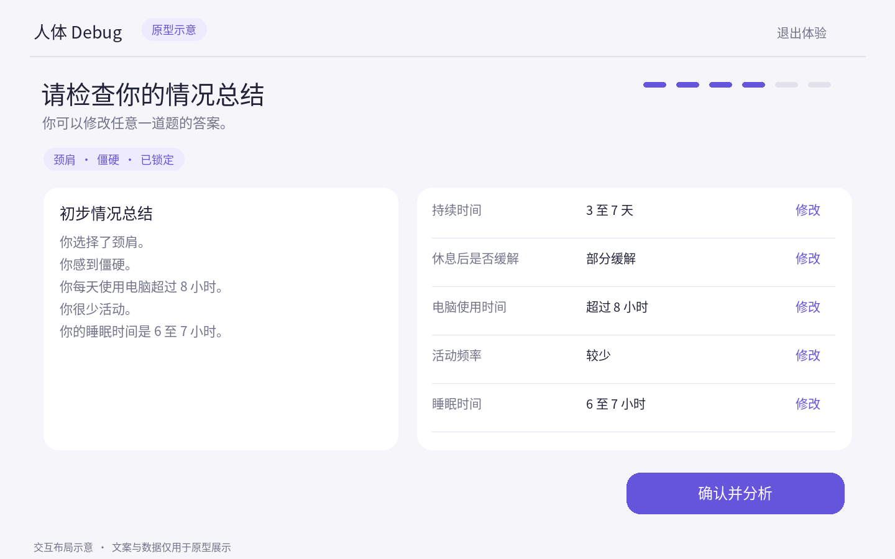
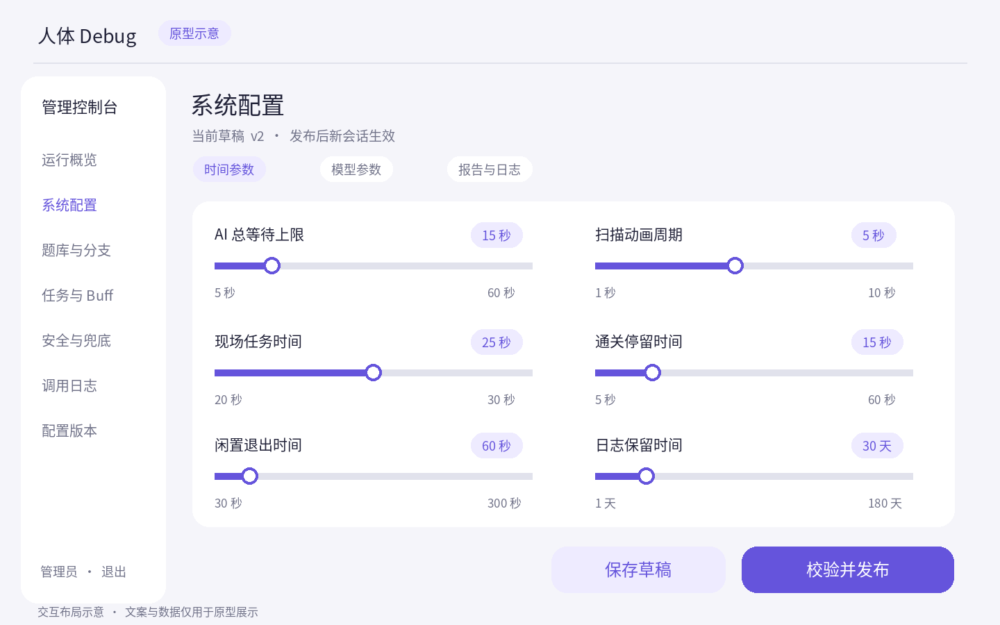
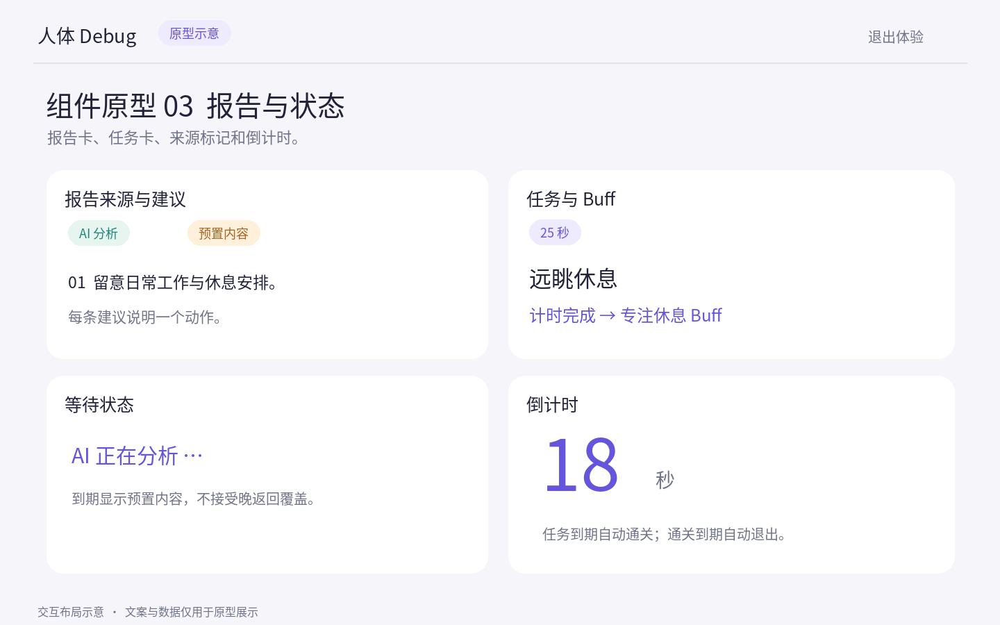

用户提供部位、感受和生活习惯，系统给出建议，再引导完成现场计时任务。理解这套设计，先看体验，再看系统如何保证结果有效。

[查阅完整设计、参数和 25 张原型图](reference.html)

## A 先明确 谁负责什么

这个产品面向现场大屏，提供健康知识和生活习惯建议。

| 参与者 | 负责的事 | 交付结果 |
| --- | --- | --- |
| 用户 | 选择部位与感受，回答习惯问题 | 已确认的输入 |
| 程序 | 控制流程、检查安全、校验结果、运行倒计时 | 可展示的报告与任务 |
| AI | 根据已确认输入分析，选择允许的 task_id | 分析文字、N 条建议、任务 ID |
| 管理员 | 审核题库、任务、安全规则和兜底内容 | 可发布的配置版本 |
| 工作人员 | 查看通关页面，现场确认奖励 | 奖励发放 |

疾病诊断、用药和治疗承诺不在产品范围内。任务倒计时结束，只表示游戏计时完成。

## B 一次体验 分四段理解

```timeline v
01 | 收集输入 | 开始 → 部位 → 感受 → 生活习惯问答
02 | 检查信息 | 自动生成总结 → 修改答案 → 最终确认
03 | 获得建议 | 扫描等待 → AI 报告或预置报告
04 | 完成体验 | 开始任务 → 倒计时结束 → Buff → 返回首页
```

### 操作为什么这样安排

- 部位和感受确认后锁定；重新选择需开始新会话。
- 每题点击即保存并推进，最后一题自动进入总结。
- 修改答案后直接回到总结；仅补答受影响的分支题。
- 最终确认后才调用 AI，避免分析尚未确认的信息。
- 任务计时结束自动通关；退出随时结束当前会话。

**安全检查贯穿流程。** 感受确认、保存答案、最终确认、报告校验都会检查规则。命中危险信号时进入安全提示页，停止普通报告、任务和 Buff。

[查看十个环节与全部操作规则](reference.html#panel-B)

## C 状态机 让每一步只有合法入口

下图聚焦确认后的状态迁移。此前依次为选择部位、选择感受和问答。

```flow
检查总结 -> 分析中: 最终确认
分析中 -> 报告就绪: AI 或预置报告有效
报告就绪 -> 任务进行中: 开始任务
任务进行中 -> 已通关: 服务端计时结束
已通关 -> 已关闭: 结束或停留超时
```

### 三条约束防止状态混乱

| 场景 | 程序必须保证 |
| --- | --- |
| 重复点击最终确认 | 同一输入和 Idempotency-Key 只创建一个分析任务 |
| AI 晚返回或输入已经变化 | 写入前匹配会话、input_revision、request_id 和当前状态 |
| 用户退出或命中安全规则 | 退出关闭会话；规则命中进入安全拦截，阻止普通流程继续 |

任务结束时间由服务端记录，前端展示剩余时间。重复点击不能重启倒计时。

[查看十种状态与版本字段](reference.html#panel-C)

## D 系统架构 把职责放到正确位置

```flow
大屏浏览器 -> 反向代理: 页面与 API 请求
反向代理 -> FastAPI: 单 Worker
FastAPI -> 模型服务: 异步调用
FastAPI -> MySQL: 配置与持久日志
```

**浏览器负责展示，FastAPI 决定状态和最终结果。** 会话初版放在服务内存中，配置和历史日志保存到 MySQL。

### 多台设备如何一起运行

asyncio 在等待网络时切换处理其他请求。模型调用通过有界队列和并发控制器，默认最多 5 个在途请求。

- 队列满：立即提供部位兜底。
- 容量降低：已有请求结束后再收紧许可。
- 增加 Worker：需共享会话和全局并发限制。

上游模型的实际并行能力与可接入设备数，需由压力测试确定。

[查看并发约束和部署建议](reference.html#panel-C)

## E AI 调用 一次等待只落定一个结果

情况总结由程序模板生成。用户确认后，系统才把输入交给 AI。

```sequence num
participants: 浏览器, 后端, 模型
浏览器 -> 后端: 最终确认输入
后端 -> 后端: 安全检查并固定输入版本
后端 --> 浏览器: 安全通过后进入扫描等待
后端 -> 后端: 排队并获取并发许可
后端 -> 模型: 部位、答案、N 和允许任务 ID
模型 --> 后端: 分析、建议和 task_id
后端 -> 后端: 校验结构、事实引用与安全
浏览器 -> 后端: 查询分析状态
后端 --> 浏览器: 返回唯一有效报告
```

### 结果按这个优先级处理

| 优先级 | 条件 | 用户看到什么 |
| --- | --- | --- |
| 1 安全 | 危险信号规则命中 | 安全提示；停止任务与 Buff |
| 2 AI | 预算内返回且校验通过 | AI 报告和审核任务 |
| 3 预置 | 队列满、超时、失败或输出不合格 | 标记为预置内容的部位兜底报告 |

**默认总等待预算为 15 秒。** 排队、调用、重试和校验共同消耗这笔预算。到期落定预置报告，AI 晚返回只能记录日志。

若校验失败且剩余预算允许，可按配置重试。AI 与兜底都必须输出恰好 N 条、不重复的建议；N 默认 3，允许 3 至 5。

[查看 Schema、输出示例与时间参数](reference.html#panel-D)

## F 数据与配置 先区分生命周期

| 内容 | 放在哪里 | 何时变化或结束 |
| --- | --- | --- |
| 当前会话、答案和报告缓存 | 浏览器与后端临时状态 | 退出后清理；服务重启使内存会话失效 |
| 题库、任务、兜底和业务配置 | MySQL 的发布版本 | 新会话读取新版本，在途会话保持快照 |
| 问答和模型调用历史 | MySQL 日志 | 管理员按权限查询，到期清理完整内容 |
| 数据库连接、主密钥、Worker 数量 | 启动配置 | 按部署配置与重启流程生效 |

### 后台编辑怎样影响体验

```flow LR
草稿 -> 校验 -> 发布版本 -> 新会话快照
```

紧急安全规则可即时作用于在途会话，并记录安全版本。模型并发容量由控制器即时调整。

**现场清理和历史日志保留是两种操作。** 首页说明日志保存，后台限制查看与导出。API 密钥、密码和会话凭证始终排除。

### 接口跟着体验走

| 用户动作 | 对应 API 责任 |
| --- | --- |
| 开始、选择、答题 | 创建会话，锁定选择，保存答案 |
| 检查总结、最终确认 | 返回模板总结，幂等启动分析 |
| 查看报告、开始任务、退出 | 查询分析状态，返回任务结束时间，关闭会话 |
| 后台编辑与发布 | 登录授权，校验配置，记录发布审计 |

[查阅字段、API、日志统计与配置范围](reference.html#panel-E)

## G 实施顺序 每阶段交付可验证的结果

```timeline v
01 | 跑通完整体验 | 状态机、题库、模板总结与前端流程
02 | 接入 AI 与异常处理 | Schema 校验、安全规则与部位兜底
03 | 建立运营后台 | 配置发布、完整日志与监控
04 | 完成现场验收 | 多设备联调、异常测试与压力测试
```

| 要验证什么 | 判断依据 |
| --- | --- |
| 体验连贯 | 自动推进、总结修改与倒计时通关符合规则 |
| 结果可靠 | 超时落定兜底，晚返回不覆盖，安全不能被绕过 |
| 会话隔离 | 至少两台设备同时体验，无答案、报告或状态串用 |
| 运营可追溯 | 配置版本可审计，日志可查且排除密钥与凭证 |

上线前审核题目、预置建议、任务和安全提示。压测记录等待 P95、兜底率、日志完整率，再确定设备容量。

[查看完整验收标准与故障处理](reference.html#panel-F)

## H 用三个画面对应上述逻辑

以下为设计原型，内容与统计值均为示例。

### 用户端 看清信息再启动分析

U05 总结确认页对应第二段体验。答案修改后自动更新总结，最终确认才启动 AI。



### 后台 把运行参数变成可发布配置

A03 时间配置页对应配置管理。时间参数使用滑条，保存草稿与发布分开。



### 公共组件 让状态与结果来源可见

C03 对应报告和计时状态。AI 等待不显示虚构百分比，报告来源始终可见。



[查看全部 25 张原型及逐图说明](reference.html#panel-G)
